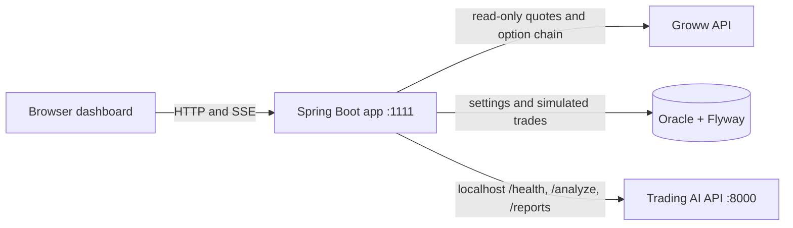

# Architecture and API guide

## Runtime architecture



- The Spring Boot app serves the dashboard and the `/api` routes on port **1111**.
- Groww calls are read-only. The scheduled collector keeps the latest NIFTY/BANKNIFTY quote and a compact option-chain snapshot in memory. The dashboard can also fetch historical OHLCV candles on demand for analysis.
- Oracle stores risk settings and synthetic paper trades. Flyway owns schema changes.
- The analysis adapter calls the separate Trading AI HTTP API. Manual analysis sends validated bars and optional market_data. Groww-backed analysis includes normalized OHLCV and the original Groww historical response in market_data. Credentials and tokens are never sent to AI; user profile, holdings, positions, and paper trades are not automatically sent.
- AI results are informational. The response is marked `tradeAuthorized=false`; no analysis endpoint calls a Groww order route or paper execution route.

## Historical candle data

The app fetches Groww historical candles on demand through GET /v1/historical/candles. It does not synthesize bars from quote snapshots. Complete valid candles are normalized to OHLCV; FNO open interest remains in the original Groww response in the AI market_data field. Requests require 50-5,000 valid completed bars. The Groww call can return fewer candles than requested because data availability varies by instrument and interval.

This is a historical-data-to-AI workflow, not a strategy simulator. The application does not calculate backtest fills, fees, or strategy P&L.

See [Groww backtesting and AI request contract](GROWW_BACKTESTING_AI_CONTRACT.md) for the exact Groww request and AI body.
## Configure and run

### Local / IntelliJ

1. Start Oracle and make sure the `GROWW_TRADER` schema/user has Flyway table and index privileges.
2. Start your Trading AI service bound to loopback at `127.0.0.1:8000`. Its required routes are `GET /health`, `POST /analyze`, `GET /reports?kind=analysis`, and `GET /reports/{report_id}`.
3. Set `TRADING_AI_ANALYSIS_URL=http://127.0.0.1:8000` and `TRADING_AI_ENABLED=true` in the IntelliJ run configuration or process environment. Spring Boot does not load `.env` for a direct run.
4. Set database and optional Groww environment values, then start the app:

```powershell
mvn -f backend/pom.xml spring-boot:run
```

Open [http://localhost:1111](http://localhost:1111). You can check the local integration with:

```powershell
curl.exe http://localhost:1111/api/ai/status
curl.exe http://localhost:1111/api/ai/reports?kind=analysis
```

### Docker Compose

Compose maps the local Trading AI host route to `http://host.docker.internal:8000`. If your service is bound strictly to host loopback, the container may not be able to reach it; in that case run the Spring app directly on the host with the loopback URL. Do not expose the Trading AI service publicly or change it to a wildcard listener just to make Compose work.

Set `TRADING_AI_ANALYSIS_URL` in `.env` if your private local Docker route differs. Keep `TRADING_MODE=PAPER` and `LIVE_TRADING_ENABLED=false`.

## Trading AI request and response

### Request accepted by this app

`POST /api/analyze` accepts the analysis fields expected by the local service. Use actual completed candles only:

```json
{
  "symbol": "RELIANCE",
  "interval": "5 seconds",
  "analysis_prompt": "Explain the trend, positive signs, negative signs, and risks.",
  "knowledge_query": "short-term trend and volume confirmation",
  "bars": [
    {
      "timestamp": "2026-10-26T09:15:05+05:30",
      "open": 100.0,
      "high": 102.0,
      "low": 99.0,
      "close": 101.0,
      "volume": 12000
    }
  ]
}
```

The body above illustrates one candle's shape; a submitted request must contain at least 50 and at most 5,000 completed bars. Each timestamp must be ISO 8601. Prices must be finite and positive; volume must be finite and non-negative; high/low must agree with open/close. Interval aliases such as `5 seconds`, `5m`, `1 hour`, and `3d` are normalized to `5s`, `5m`, `1h`, and `3d`. Unknown top-level fields are rejected. The optional market_data object is passed through unchanged for Groww historical analysis; credentials and account endpoints are not part of that request.

Example Postman setup:
- Method: `POST`
- URL: `http://localhost:1111/api/analyze`
- Header: `Content-Type: application/json`
- Body: raw JSON, with the complete valid payload above and 50–5,000 actual completed bars

Windows curl example after saving that complete Postman body as `analysis-request.json`:

```powershell
curl.exe --request POST "http://localhost:1111/api/analyze" --header "Content-Type: application/json" --data-binary "@analysis-request.json"
```

The API response is the structured report from Trading AI. The adapter preserves `report_id`, `timeframe`, `trend`, `summary`, `indicators`, evidence/reason arrays, knowledge fields, and limitations. It adds `provider`, `mode`, `totalLatencyMs`, and `tradeAuthorized=false`.

### Trading AI report fields

The local response includes:
- `report_id`, `analysis_prompt`, `symbol`, `interval`, `as_of`
- `timeframe`: normalized interval, labels, bar count, first/last bars, elapsed coverage, and nominal lookbacks
- `trend`, `summary`
- `indicators`: latest close, SMA 20/50, returns, RSI 14, ATR 14, ATR percent, relative volume, directional alignment, and analyzed bar count
- `evidence`, `positive_reasons`, `negative_reasons`, `risk_notes`
- `knowledge_query`, `knowledge_context`, `knowledge_status`, `limitations`

The dashboard renders these fields and provides buttons to list/open saved analysis reports. Report data and indicator values are not replaced with illustrative values.

### Analysis failure behavior

- Missing body or candle history: `CANDLES_REQUIRED`; the local model is not called.
- Invalid request or fewer than 50 / more than 5,000 bars: `INVALID_REQUEST`; the local model is not called.
- Trading AI HTTP 422: `INVALID_CANDLES`.
- Trading AI HTTP 503: `BUSY`; `Retry-After` is passed through when supplied.
- Timeout or offline API: `UNAVAILABLE`.
- These responses all include `tradeAuthorized=false`; Groww polling and paper-trade endpoints remain independent.

## Application API routes

Base URL: `http://localhost:1111/api`.

| Method and route | Purpose |
|---|---|
| `GET /health` | App health; always reports PAPER and live execution disabled |
| `GET /dashboard` | Risk settings and today's paper-trading totals |
| `GET /settings` | Current risk settings |
| `PUT /settings` | Validate and update paper risk settings |
| `POST /analyze` | Validate and proxy an OHLCV analysis request |
| `POST /analyze/stream` | SSE wrapper; emits `meta`, structured `report`, and `done` events |
| `GET /ai/status` | Trading AI health, configured URL, timeout, and candle-source availability |
| `GET /ai/reports?kind=analysis` | Proxy the saved analysis report list |
| `GET /ai/reports/{report_id}` | Proxy one saved report |
| `GET /groww/status` | Groww credential/token readiness; never returns secrets or access tokens |
| `GET /market/overview` | Latest cached NIFTY/BANKNIFTY LTP and source state |
| GET /market/quote, /market/ltp, /market/ohlc, /market/option-chain, /market/greeks | Read-only Groww live market data |
| GET /market/expiries, /market/contracts | Discover backtesting expiries and derivative contracts |
| POST /market/historical-candles | Fetch and return Groww historical response envelope |
| POST /backtesting/analyze | Fetch Groww candles and send bars plus raw response to Trading AI |
| GET /groww/user/profile, /groww/portfolio/holdings, /groww/portfolio/positions, /groww/portfolio/position, /groww/instruments.csv | Read-only Groww profile, portfolio, and instrument metadata |
| `GET /trades` | Saved synthetic paper-trade journal |
| `GET /trades/{id}` | One synthetic paper trade and its result |
| `POST /paper/execute` | Create a simulated paper entry |
| `POST /paper/close/{id}` | Close a simulated paper position |
| `POST /paper/square-off` | Close all simulated open positions |
| `GET /actuator/health` | Spring Boot health endpoint |

The dashboard and paper-trade API remain paper-only. None of the routes above creates, modifies, cancels, or checks a real Groww order.

## Groww data flow

When Groww is enabled and credentials are configured, the backend obtains an access token through the existing auth service and calls read-only market endpoints. The one-second quote refresh requests NSE_NIFTY and NSE_BANKNIFTY LTP values. The scheduled option-chain refresh selects the next NIFTY expiry, fetches the chain, and compacts the nearest strikes. Historical analysis passes the full candle response to Trading AI as market_data.response; account profile, holdings, and positions are not added automatically.

Current source fields for analysis are not suitable substitutes for candles: LTP snapshots lack open/high/low/volume and the option chain describes contracts rather than a candle series. Groww login, collection, and order behavior are unchanged by this integration.

## Database and safety

Flyway creates `GROWW_TRADER.TRADING_SETTINGS` and `GROWW_TRADER.PAPER_TRADES`. The app keeps market snapshots and AI reports outside Oracle; reports are stored by the Trading AI service.

Live execution remains disabled in configuration. Analysis cannot authorize a trade, and the app does not turn AI output into an order. Keep the application on a trusted local network; the project currently has no API authentication layer.
