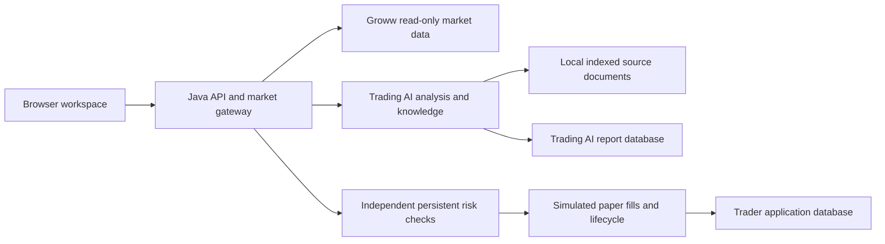

# Trading workspace architecture and navigation

Analysis context, multiple timeframes and historical research replay are documented in [Analysis research guide](ANALYSIS_RESEARCH_V2.md). Both interfaces include a labelled synthetic example; replay reports do not create paper positions.

The Groww trader is the user interface, market-data gateway and independent paper-execution/risk service. Trading AI performs analysis, knowledge retrieval, candidate evaluation and report storage. The browser never authorizes a trade on its own. This update completes the workspace navigation and consolidates the existing UI workflows; it does not implement real broker execution.

## Screen routes

| URL | Purpose |
| --- | --- |
| `/workspace/overview` | Portfolio P&L, selected stock, fill chart, market context and next action |
| `/workspace/automation` | Explicit paper opt-in, start/apply, stop/exit, activity and session limits |
| `/workspace/analysis` | Latest automatic AI explanation; manual candle analysis and historical backtest |
| `/workspace/reports` | Saved analysis questions, symbol/interval/trend and searchable recent history |
| `/workspace/reports/123` | One saved question, response, positive/negative reasons, risks and sources |
| `/workspace/positions` | Open, closed and rejected records, search/filter and 50-record pages |
| `/workspace/positions/{intentId}` | Addressable position details and lifecycle snapshot |
| `/workspace/risk` | Effective limits, dashboard settings, kill switch and separate admin controls |
| `/workspace/tools` | Market/breadth/sector assessment, maintained stock list, scan, review and news |

`/`, `/index.html`, the earlier `#overview`/`#analysis` style links and `/paper-workspace.html` continue to work. `/research-tools.html` now opens the connected Research tools screen. Old links are replaced in browser history with the canonical route. Each sidebar entry is a real anchor: copy-link, opening a new tab, refresh and browser back/forward work. Titles, focus and the active navigation link follow the route.

Spring's `WorkspaceController` forwards only explicitly supported UI paths to the single `index.html` shell. It does not turn missing `/api/*`, missing JavaScript or unknown workspace paths into an HTML success response. Unknown server URLs return 404. The small legacy HTML files are fallback links rather than duplicate application shells.

## Responsibilities

* `workspace-router.js`: one route registry, canonical URLs, detail identifiers and history transitions. It has no trading side effects.
* `workspace-api.js`: one in-memory connection token, local API paths, request timeout, structured errors and concurrent GET deduplication. Reads are not cached after completion. Mutations are neither automatically retried nor deduplicated. Credentials go only to local `/api/v1/` paths and never into URLs or browser storage.
* `workspace-shell.js`: screen lifecycle, headings/focus, service badges, connection/stale state, session and policy presentation. Navigation keeps unsaved forms in the same DOM.
* `automatic-paper.js`: one non-overlapping status refresh, portfolio/chart rendering, position routes and explicit execution controls. A connection generation prevents a previous token's late response from overwriting a newer connection. A failed chart does not discard otherwise valid service status; authorization failure still suspends polling.
* `analysis-view.js`: readable automatic decisions, indicators, positive/negative reasons, risks, candidates and source context.
* `workspace-reports.js`: list/detail loading, search, empty/error states and late-response suppression. Report content is rendered separately from an in-progress manual analysis. The list reflects the latest records returned by the existing AI report proxy; it is not a full database search.
* `workspace-research.js`: research steps use the same connection and API client. A changed market input invalidates an earlier proposal. A reviewed BUY proposal still needs the user's confirmation; its decision ID is the idempotency key. Scans poll sequentially only while the research screen is active; leaving does not cancel the server job.
* `workspace-legacy.js`: isolated adapter for the existing historical analysis, backtest, dashboard settings and legacy demo records. This removes the large inline script without rewriting proven contracts.
* `trading-ai-session.js`: optional five-second session analysis, paused when its screen is hidden. This browser research loop does not place trades.

## Refresh and connection behavior

Automatic server trading continues independently of browser navigation. Browser status checks run every five seconds while visible and connected. Market overview reads run only on Overview, with at most one outstanding read. Dashboard settings/legacy history refresh on their relevant screens. Service checks run every 15 seconds while visible. A hidden browser pauses UI work; it does not stop server automation or position protection.

Connecting verifies status; it does not start automation. Failed updates show a stale-data warning and last-success time. A 401 pauses protected polling until a token is entered again. Recoverable failures have Retry connection. Disconnect clears the page's token and confirmation and pauses its research activity; it does not stop server automation. Existing values remain visibly labelled as potentially stale. Full page reload/new tab requires reconnection because tokens are intentionally kept only in memory.

Positions and report URLs preserve identifiers, not credentials. A position dialog is a snapshot when opened; the portfolio footer continues to refresh. Saved reports are read-only evidence, not instructions to execute a trade. No navigation or report read starts, stops or exits a position.

## Execution boundary

Updated 6 November 2026: the Paper/Real header control selects the persisted execution destination. Switching pauses automation and is refused while managed exposure is active or unresolved. GrowwOrderAdapter and LiveExecutionService provide broker submission and trade reconciliation for the real path. See [REAL_TRADING.md](REAL_TRADING.md) for activation, tested behavior and live validation still required. Market session verification, data completeness, freshness, sizing, liquidity, daily loss, position limits, kill switch, durable intents and paper exits retain their existing backend checks.

The normal automatic strategy still requires its configured history and confirmation. Informational early-session analysis can accept fewer completed candles and marks unavailable indicators. Seconds/minutes/hours/days are analysis timeframes where supported by the existing API, not a promise of millisecond execution or guaranteed forecasting. Backend source documents and the Python model were not changed by this UI architecture update.

## Verification and use

Run `node --test tests/*.test.cjs` from the repository root. Run `mvn -f backend/pom.xml test` for the Java suite. Router/API tests cover aliases, IDs, canonicalization, history, request deduplication, token isolation, mutation failure and recovery. Spring startup tests fetch every direct UI route and check missing API/assets/unknown screens return 404 while risk authentication and live rejection remain enforced.

Browser verification uses a synthetic isolated preview with no broker connection and a write counter. Check navigation, report list/detail, refresh, back/forward, research stock-list reads, connection failure/recovery, position details, settings preservation, real-mode explanation and mobile layout. Never verify this UI by placing a live order.

After installing the built version, restart the Java app, open `http://localhost:1111/workspace/overview`, and press Ctrl+F5. Connect with the existing shared token. A Java restart pauses automatic entries; review Automation and explicitly start paper auto mode when wanted. The Python service can remain running for this update.
